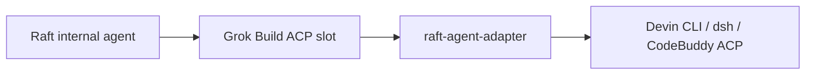

# raft-agent-adapter

[English](README.md) · [简体中文](README.zh-CN.md)

[](https://github.com/sealpp/raft-agent-adapter/actions/workflows/ci.yml)
[](LICENSE)

[](https://github.com/sealpp/raft-agent-adapter/stargazers)

**Raft's internal agents can't drive Devin CLI, DeepSeek Harness, or CodeBuddy Code — this adapter bridges the gap.** It sits in Raft's existing Grok Build runtime slot and translates between the two ACP dialects, so your backend of choice becomes a real runtime option: backend-prefixed models appear in Raft's picker, thinking levels map to the backend's own options, and sessions, permissions, and streamed updates pass through. Windows and Linux; nothing inside Raft is modified.



> Experimental community project, unaffiliated with Raft, Cognition, DeepSeek, or xAI. The runtime selector keeps showing **Grok Build** — that's expected, and a real Grok installation cannot share the slot.

**Setting up with an AI agent?** [AGENTS.md](AGENTS.md) is a condensed runbook. If it works for you, a [star](https://github.com/sealpp/raft-agent-adapter) helps others find it.

## What you get

- Backend models in Raft's picker (`Devin · …` / `DSH · …` / `CodeBuddy · …`), each with its native thinking levels
- Model + thinking level as two independent Raft controls — the adapter maps them to the backend's native configuration
- HTTP ACP transport for CodeBuddy: one lightweight adapter per agent shares a single per-host CodeBuddy server. Each agent gets its own ACP connection and session on CodeBuddy's Web UI client path, so several agents run concurrently without one heavy process each. When the last adapter detaches, the shared backend stops and resumes sessions on the next message
- See [the shared-backend notes](docs/codebuddy-shared-backend.md) for the measured CodeBuddy behavior, process model, and limits
- Native session resume on the same computer, without replaying history into Raft
- Standing instructions, permission requests, streaming, and usage data forwarded both ways
- Mid-turn messages: delivered natively on Devin, queued until the current turn ends on dsh and CodeBuddy
- Devin and CodeBuddy sessions open with the backend's most permissive mode (`bypass` / `fullAccess`) — the same no-approval posture Raft gives Codex

## Verification status

| Backend | Live check | Verified on |
| --- | --- | --- |
| Devin CLI | Real prompt → real inference reply | Linux, Raft Computer 1.0.67 → Devin CLI 3000.12.32 (predates the multi-backend refactor) |
| CodeBuddy Code | Prompt + model/thinking selection + session resume; five concurrent sessions on one shared backend | CodeBuddy 2.182.0, signed-in China-site account |
| DeepSeek Harness | Not yet run against a real `dsh` binary | Offline protocol suite only |

Windows inference, permission prompts, and mid-turn edge cases remain unverified — treat as experimental.

## Quick start

Prerequisites: **Node.js 22+**, Git, a working Raft Computer, and one installed, signed-in backend CLI.

```sh
# Linux
curl -fsSL https://cli.devin.ai/install.sh | bash   # install Devin CLI → ~/.local/bin/devin
devin setup                                          # sign in
git clone https://github.com/sealpp/raft-agent-adapter.git && cd raft-agent-adapter
platform/linux/install.sh
npm run models:refresh
platform/linux/test-adapter.sh
```

```powershell
# Windows (PowerShell)
git clone https://github.com/sealpp/raft-agent-adapter.git; cd raft-agent-adapter
.\platform\windows\Install.ps1
.\platform\windows\Refresh-Models.ps1
.\platform\windows\Test-Adapter.ps1
```

The installer places a `grok` trampoline in `~/.local/bin` and links it from `~/.grok/bin` (a path Raft probes directly, even when `~/.local/bin` is not on the daemon's PATH); the refresh/test scripts read model and thinking options without sending an inference prompt. `Another grok exists` means another checkout owns the slot — run its uninstaller first. A blocked PowerShell script can be run once with `powershell.exe -NoProfile -ExecutionPolicy Bypass -File …`.

Then in Raft: add an **internal agent → Grok Build → refresh the model list → pick a backend-prefixed model**. If Grok Build is missing from the runtime inventory, rescan runtimes or restart the Computer (the workspace **Scan** action does not rescan runtimes).

## Backends

Set `"backend"` in `adapter.config.json` (copy from `adapter.config.example.json`) or export `RAFT_ADAPTER_BACKEND`. One backend is active per installation.

| `backend` value | Runs | Sign in | Notes |
| --- | --- | --- | --- |
| `devin` | `devin acp` | `devin setup` | `auto` picks Devin when its CLI is found |
| `dsh` | `dsh acp` | `dsh web` or `~/.dsh` config | Cold start can exceed Raft's ~15 s model-detection window |
| `codebuddy` | `codebuddy --acp` | `codebuddy` once, or `CODEBUDDY_API_KEY` | Never auto-selected; sessions created in its own terminal UI can't resume via Raft |

After switching backends, refresh Raft's model list and re-pick a model — an ID from the other backend is rejected explicitly rather than misrouted.

## Models and thinking levels

Raft shows **family** model IDs (`devin:swe-2`); the level lives in the separate reasoning-effort selector. To get SWE-2 Max, pick the SWE-2 model and set **Reasoning effort → Max**:

| Raft choice | Native Devin configuration |
| --- | --- |
| Model: Devin SWE-2 | `model = swe-2-high` |
| Reasoning: Medium / High / Max | `thought_level = medium / high / max` |
| Reasoning: Default | The model's native preset (SWE-2: High) |

Hand-written combos (`devin:swe-2-max`) and saved profiles with a raw base ID (`devin:swe-2-high`) still resolve to the right configuration. After a backend CLI update, rerun `npm run models:refresh` and refresh Raft's model list.

Raft's model probes are answered from `.local/initialize-cache.json` while it matches the installed backend, so detection does not start a backend process. The entry refreshes on every real session open and on `npm run models:refresh`. If the model list looks stale after an account or backend change, delete `.local/initialize-cache.json` or rerun `npm run models:refresh`, then refresh Raft's model list. On machines where the backend's cold start exceeds Raft's ~15 s detection window, run `npm run models:refresh` once after install and sign-in to pre-warm the cache.

## Configuration

All optional — sensible defaults discover each backend at its standard install path, then PATH. Copy `adapter.config.example.json` to `adapter.config.json` (git-ignored), or pass `--devin-exe` / `--proxy-url` (`-DevinExe` / `-ProxyUrl` on Windows) to the installer.

| Setting | Priority |
| --- | --- |
| `backend` | `RAFT_ADAPTER_BACKEND` → config → `auto` |
| Backend executable | `DEVIN_EXE` / `DSH_EXE` / `CODEBUDDY_EXE` → config → standard path → PATH |
| Proxy | `RAFT_ADAPTER_PROXY` → config → inherited environment |
| Config file | `RAFT_ADAPTER_CONFIG` → checkout's `adapter.config.json` |
| HTTP ACP transport | CodeBuddy only, on by default. A per-host daemon owns one loopback server; every agent opens its own connection/session. Set `RAFT_ADAPTER_HTTP=0` to use stdio |
| HTTP idle stop | CodeBuddy only; default 5 minutes. Idle adapters detach and the shared backend stops after the last client; the next prompt restarts it and resumes each session. Set `RAFT_ADAPTER_HTTP_IDLE_MS=0` to keep it warm |

An explicit proxy sets `HTTP_PROXY`, `HTTPS_PROXY`, and `ALL_PROXY` on the backend child process only — it starts no proxy server and changes nothing system-wide.

## Update and uninstall

Pull a reviewed update → rebuild the launcher (`platform/linux/build.sh` / `platform\windows\Build.ps1`) → refresh models. Re-verify after upgrading Raft or a backend CLI.

`platform/linux/uninstall.sh` / `platform\windows\Uninstall.ps1` removes this checkout's PATH entry only — sessions, sources, and other PATH entries are preserved.

## Development

```sh
npm run check && npm test                 # offline protocol suite — no account needed
platform/linux/test-adapter.sh --live     # real-CLI configuration checks — no prompts sent
```

`npm test` runs against a deterministic fake peer; `--live` verifies the real backend's configuration surface (model list, thinking levels, invalid-value rejection) without inference. Normal agent work uses your account's credits. A Docker verification image lives in `docker/` (`docker build -f docker/Dockerfile .` runs the full suite; pass `-e DEVIN_API_KEY=…` for authenticated checks).

See [contributing](CONTRIBUTING.md) and [security reporting](SECURITY.md).

## License

[MIT](LICENSE). Raft, Devin, DeepSeek, and Grok names belong to their owners; protocol compatibility implies no endorsement.