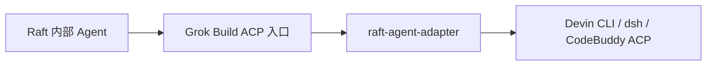

# raft-agent-adapter

[English](README.md) · [简体中文](README.zh-CN.md)

[](https://github.com/sealpp/raft-agent-adapter/actions/workflows/ci.yml)
[](LICENSE)

[](https://github.com/sealpp/raft-agent-adapter/stargazers)

**Raft 的内部 Agent 本来用不了 Devin CLI、DeepSeek Harness 和 CodeBuddy Code——这个适配器补上这块缺口。** 它挂在 Raft 已有的 Grok Build 运行时入口上，在两种 ACP 方言之间做翻译：所选后端就变成真实可用的运行时——模型列表里出现带前缀的选项，思考强度按后端自己的档位走，会话、权限请求、流式更新照常透传。Windows 和 Linux 都支持，不改动 Raft 本身。



> 实验性社区项目，与 Raft、Cognition、DeepSeek、xAI 均无隶属关系。运行时选择器会一直显示 **Grok Build**——属正常现象；已安装的真实 Grok 无法共用此入口。

**让 AI Agent 帮你装？** [AGENTS.md](AGENTS.md) 里有一份精简 runbook。好用的话点个 [star](https://github.com/sealpp/raft-agent-adapter)。

## 你将获得

- 后端模型进入 Raft 模型列表（`Devin · …` / `DSH · …` / `CodeBuddy · …`），各自带原生思考档位
- 模型与思考强度是 Raft 里两个独立控件——适配器负责映射成后端原生配置
- CodeBuddy HTTP ACP：每个 agent 一个轻量 adapter 进程，共享每主机一个 CodeBuddy 后端；每个 agent 独立 connection/session，可并发运行；最后一个 adapter 退出后后端停止，下次请求再恢复会话
- 共享后端调研与进程模型见 [docs/codebuddy-shared-backend.md](docs/codebuddy-shared-backend.md)
- 同机原生会话续接，不把历史重放进 Raft
- 常驻指令、权限请求、流式更新、用量数据双向透传
- 中途消息：Devin 原生投递；dsh 与 CodeBuddy 排队到当前轮结束后补发
- Devin 和 CodeBuddy 会话以各自最宽松模式打开（`bypass` / `fullAccess`），与 Raft 给 Codex 的"不询问"姿态一致

## 验证状态

| 后端 | 实测内容 | 验证环境 |
| --- | --- | --- |
| Devin CLI | 真实 prompt → 真实推理回复 | Linux，Raft Computer 1.0.67 → Devin CLI 3000.12.32（早于多后端重构） |
| CodeBuddy Code | prompt + 模型/思考选择 + 会话续接；单后端 5 个并发会话 | CodeBuddy 2.182.0，国内版已登录账号 |
| DeepSeek Harness | 尚未对真实 `dsh` 二进制验证 | 仅离线协议套件 |

Windows 推理、权限请求与在途消息边界情况尚未验证——按实验性软件对待。

## 快速开始

准备：**Node.js 22+**、Git、可用的 Raft Computer、一个已安装并完成登录的后端 CLI。

```sh
# Linux
curl -fsSL https://cli.devin.ai/install.sh | bash   # 安装 Devin CLI → ~/.local/bin/devin
devin setup                                          # 登录
git clone https://github.com/sealpp/raft-agent-adapter.git && cd raft-agent-adapter
platform/linux/install.sh
npm run models:refresh
platform/linux/test-adapter.sh
```

```powershell
# Windows（PowerShell）
git clone https://github.com/sealpp/raft-agent-adapter.git; cd raft-agent-adapter
.\platform\windows\Install.ps1
.\platform\windows\Refresh-Models.ps1
.\platform\windows\Test-Adapter.ps1
```

安装脚本把 `grok` 引导程序放到 Raft 查找的位置；刷新/测试脚本只读取模型与思考选项，不发送推理提示。报 `Another grok exists` 说明已有其他检出占用入口——先运行其卸载脚本。PowerShell 执行策略拦截时，可对单个脚本用 `powershell.exe -NoProfile -ExecutionPolicy Bypass -File …`。

然后在 Raft 里：添加**内部 Agent → Grok Build → 刷新模型列表 → 选带前缀的模型**。运行时清单里没有 Grok Build 时，Rescan Runtimes 或重启 Computer（工作区的 **Scan** 不会重扫运行时）。

## 后端选择

在 `adapter.config.json`（由 `adapter.config.example.json` 复制）中设置 `"backend"`，或导出 `RAFT_ADAPTER_BACKEND`。一个安装同时只接一个后端。

| `backend` 值 | 执行 | 登录方式 | 备注 |
| --- | --- | --- | --- |
| `devin` | `devin acp` | `devin setup` | 找到 Devin CLI 时 `auto` 默认选它 |
| `dsh` | `dsh acp` | `dsh web` 或 `~/.dsh` 配置 | 冷启动可能超过 Raft 约 15 秒的模型探测窗口 |
| `codebuddy` | `codebuddy --acp` | 运行一次 `codebuddy`，或 `CODEBUDDY_API_KEY` | 从不自动选择；在其终端界面建的会话无法经 Raft 续接 |

切换后端后，刷新 Raft 模型列表并重选模型——另一后端的旧 ID 会被明确拒绝，而不是静默错路由。

## 模型与思考强度

Raft 展示的是**家族**模型 ID（`devin:swe-2`），档位由独立的推理强度选项承载。要用 SWE-2 Max：选 SWE-2 模型，**Reasoning effort → Max**：

| Raft 中的选择 | Devin 原生配置 |
| --- | --- |
| 模型：Devin SWE-2 | `model = swe-2-high` |
| 推理强度：Medium / High / Max | `thought_level = medium / high / max` |
| 推理强度：Default | 该模型的原生预设（SWE-2 为 High） |

手写组合 ID（`devin:swe-2-max`）和已保存的旧基础 ID（`devin:swe-2-high`）同样能解析到正确配置。后端 CLI 升级后，重跑 `npm run models:refresh` 并刷新 Raft 模型列表。

当 `.local/initialize-cache.json` 与当前后端匹配时，Raft 的模型探测直接由缓存应答，不再启动后端进程。该缓存条目会在每次真实会话打开和 `npm run models:refresh` 时刷新。账号或后端变更后若模型列表疑似过期，删除 `.local/initialize-cache.json` 或重跑 `npm run models:refresh`，再刷新 Raft 模型列表。若机器上后端冷启动超过 Raft 约 15 秒的探测窗口，请在安装和登录后运行一次 `npm run models:refresh` 预热缓存。

## 配置

全部可选——默认按标准安装路径查找各后端，然后 PATH。将 `adapter.config.example.json` 复制为 `adapter.config.json`（已被 Git 忽略），或给安装脚本传 `--devin-exe` / `--proxy-url`（Windows 为 `-DevinExe` / `-ProxyUrl`）。

| 配置项 | 优先级 |
| --- | --- |
| `backend` | `RAFT_ADAPTER_BACKEND` → 配置文件 → `auto` |
| 后端程序路径 | `DEVIN_EXE` / `DSH_EXE` / `CODEBUDDY_EXE` → 配置文件 → 标准路径 → PATH |
| 代理 | `RAFT_ADAPTER_PROXY` → 配置文件 → 继承环境变量 |
| 配置文件 | `RAFT_ADAPTER_CONFIG` → 检出目录的 `adapter.config.json` |
| HTTP ACP 传输 | 仅 CodeBuddy，默认开启。每主机一个 daemon 持有单个 loopback 后端，每个 agent 独立 connection/session。`RAFT_ADAPTER_HTTP=0` 回退 stdio |
| HTTP 空闲停止 | 仅 CodeBuddy，默认 5 分钟。空闲 adapter 断开连接，最后一个客户端退出后共享后端停止；下次请求重启并恢复会话。`RAFT_ADAPTER_HTTP_IDLE_MS=0` 保持常驻 |

显式代理只为**后端子进程**设置 `HTTP_PROXY`、`HTTPS_PROXY`、`ALL_PROXY`——不启动代理服务，也不改动系统代理。

## 更新与卸载

拉取已审阅的更新 → 重建启动器（`platform/linux/build.sh` / `platform\windows\Build.ps1`）→ 刷新模型。升级 Raft 或后端 CLI 后应重新验证。

`platform/linux/uninstall.sh` / `platform\windows\Uninstall.ps1` 只移除本检出的 PATH 入口——源码、会话和其他 PATH 项均保留。

## 开发与验证

```sh
npm run check && npm test                 # 离线协议套件——无需账号
platform/linux/test-adapter.sh --live     # 真实 CLI 配置面检查——不发送推理
```

`npm test` 用确定性的 fake peer 跑；`--live` 检查真实后端的配置面（模型列表、思考档位、非法值拒绝），不做推理。正常 Agent 任务消耗你的账号额度。`docker/` 里有验证镜像（`docker build -f docker/Dockerfile .` 跑完整套件；传 `-e DEVIN_API_KEY=…` 覆盖认证检查）。

参阅[贡献说明](CONTRIBUTING.md)和[安全反馈](SECURITY.md)。

## 许可证

[MIT](LICENSE)。Raft、Devin、DeepSeek、Grok 名称归各自权利人所有；协议兼容不代表厂商背书。